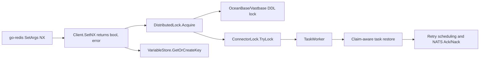

# RAGFlow PR #20746 技术复盘：传播 Kvrocks `SetNX` 错误

## 1. 文档目的

本文记录 RAGFlow [PR #20746](https://github.com/infiniflow/ragflow/pull/20746) 从选题、实现、审核修正、上游同步到最终合并的完整过程，并总结本次工作对项目可靠性、可维护性和测试覆盖的贡献。

这是一份贡献过程复盘，不是 RAGFlow 的用户功能文档。它可用于后续维护、个人开源贡献总结，以及处理类似分布式锁和消息重试问题时的参考。

## 2. PR 概览

| 项目 | 内容 |
| --- | --- |
| PR | [#20746: fix(kvrocks): propagate SetNX errors](https://github.com/infiniflow/ragflow/pull/20746) |
| 关联 Issue | [#20660: kvrocks Client.SetNX returns only bool, so a transport error looks like a held lock](https://github.com/infiniflow/ragflow/issues/20660) |
| 作者 | `eleven914` |
| 创建时间 | 2026-10-10 18:40（北京时间） |
| 合并时间 | 2026-10-16 22:02（北京时间） |
| 合并人 | `yuzhichang` |
| 最终状态 | 已合并 |
| 改动规模 | 11 个文件，新增 530 行，删除 255 行 |
| 最终提交 | `3325c50bf0ffff75182efc379bd9f15d056c1ef8` |

## 3. 问题背景

原有 `Client.SetNX` 只返回 `bool`：

```go
ok, err := r.client.SetNX(ctx, key, value, exp).Result()
if err != nil {
    common.Warn("Redis SetNX error", zap.String("key", key), zap.Error(err))
    return false
}
return ok
```

这个接口把两种语义完全不同的结果都压缩成了 `false`：

1. key 已存在，即锁被其他实例持有。这是正常的锁竞争，调用方可以等待或重试。
2. Kvrocks 连接、认证或传输失败。这是基础设施错误，调用方应立即返回错误。

当调用方轮询获取锁时，第二种情况会被误判为第一种情况。结果是系统在 Kvrocks 故障期间持续等待，直到锁超时后才返回一个误导性的“获取锁失败”，真实的后端错误只存在于重复打印的警告日志中。

### 3.1 修复后需要建立的契约

| 返回值 | 含义 | 调用方行为 |
| --- | --- | --- |
| `true, nil` | 成功写入并获得锁 | 继续执行业务 |
| `false, nil` | key 已存在，发生正常竞争 | 等待、重试或重新调度 |
| `false, err` | Kvrocks 操作失败 | 立即传播错误，不伪装成竞争 |

这一契约是本次改动的核心。后续对分布式锁、DDL 锁、变量初始化和同步任务的修改，都是为了让这个错误语义完整地穿过调用链。

## 4. 技术方案



### 4.1 Kvrocks 原子写入

- 将 `Client.SetNX` 从仅返回 `bool` 改为返回 `(bool, error)`。
- 使用 go-redis 的 `SetArgs` 和 `Mode: "NX"`，替换已弃用的 `SetNX` API。
- 将 `redis.Nil` 明确解释为“key 已存在”，返回 `false, nil`。
- 对连接、认证和传输错误增加上下文后向上传播。
- 对未初始化的客户端返回明确错误，而不是静默返回 `false`。

### 4.2 分布式锁清理与获取

- 将公开的、只返回 `bool` 的 `DeleteIfEqual` 收敛为私有的 `deleteIfEqual`。
- `deleteIfEqual` 返回 `(bool, error)`，避免 Lua 脚本执行错误被吞掉。
- `DistributedLock.Acquire` 在清理同一 owner 遗留的锁失败时立即返回错误，不再继续执行 `SetNX`。
- `SpinAcquire` 只对真正的锁竞争继续等待；后端错误立即返回。
- `Release` 增加 nil 安全处理，并把清理失败视为释放失败。

### 4.3 错误传播到业务调用方

- `VariableStore.SetNX` 接口同步改为 `(bool, error)`；`GetOrCreateKey` 不再把存储故障当成并发创建竞争。
- OceanBase 和 Vastbase 的 DDL 锁在 Kvrocks 获取失败时返回带锁名的上下文错误。
- `ConnectorLocker.TryLock` 改为返回 `(lease, acquired, error)`，区分本地或分布式锁竞争与后端故障。
- 分布式锁获取失败时清理本地 reservation，避免本进程留下假占用。

### 4.4 同步任务恢复和消息确认

错误传播到 syncer 后，任务恢复语义也必须同步完善，否则可能出现任务永久停留在 `Running` 的问题。

- `RescheduleClaimed` 增加 `time_started` 所有权条件，只允许当前 claim 的 worker 恢复任务，避免延迟重试覆盖更新的 claim。
- 返回 `restored` 状态，只有实际恢复成功时才发布重试。
- 恢复操作最多尝试 3 次，每次间隔 50 ms，应对短暂数据库错误。
- worker context 已取消时使用 `context.WithoutCancel` 完成必要的任务恢复和重试安排。
- 对无法重新 claim 且仍处于 `Running` 的重投消息执行 `Nack`，避免过早 `Ack` 后任务失去后续处理机会。
- 对已完成、已取消或已删除任务的过期消息安全 `Ack`。

这一部分把 Kvrocks 错误处理从“函数签名修复”提升为端到端的一致性修复：存储错误、数据库状态和 NATS 消息确认能够形成一致的失败恢复路径。

## 5. 主要改动文件

| 文件 | 主要内容 |
| --- | --- |
| `internal/engine/kvrocks/redis.go` | `SetNX`、锁获取、条件删除和释放的错误语义 |
| `internal/engine/kvrocks/redis_test.go` | 成功、竞争、连接失败、清理失败和未初始化场景 |
| `internal/server/variable.go` | 变量原子创建过程传播 `SetNX` 错误 |
| `internal/server/variable_test.go` | 变量已存在、创建成功、竞争和存储错误测试 |
| `internal/engine/oceanbase/schema.go` | OceanBase DDL 锁错误传播 |
| `internal/engine/vastbase/schema.go` | Vastbase DDL 锁错误传播 |
| `internal/syncer/connector_lock.go` | connector 锁区分竞争与后端错误 |
| `internal/syncer/task_worker.go` | claim 恢复、重试发布和 Ack/Nack 语义 |
| `internal/syncer/syncer_test.go` | 锁错误、取消、恢复失败和消息确认测试 |
| `internal/dao/sync_task.go` | 所有权感知的任务状态查询和恢复 |
| `internal/dao/sync_task_test.go` | 防止旧 worker 覆盖新 claim 的测试 |

## 6. 开发与审核时间线

### 2026-10-09：问题提出

Issue #20660 指出 `SetNX` 的 bool-only 返回值无法区分锁竞争和 Kvrocks 传输错误，并说明该问题会使锁调用方在后端故障时无意义地轮询到超时。

### 2026-10-10：初始修复和 PR 创建

- 提交 `8cac719d8`：修改 `SetNX` 契约并将错误传播到现有调用方。
- 创建 PR #20746。
- CodeRabbit 指出 go-redis 的 `SetNX` API 已弃用。
- 提交 `f426d0d53`：改用 `SetArgs`、`Mode: "NX"` 和 TTL，并正确处理 `redis.Nil`。
- 同步上游 `main`，处理代码演进带来的冲突。

### 2026-10-12：补齐锁清理错误和退出恢复

- CodeRabbit 指出 `DistributedLock.Acquire` 忽略 `DeleteIfEqual` 错误，仍可能把清理失败伪装成锁竞争。
- 提交 `96a7191d3`：传播条件删除错误，并收敛辅助 API。
- 上游同期加入 Kvrocks 内存 fallback，合并后重新安置测试并解决冲突。
- CodeRabbit 指出 worker 退出时使用已取消 context 安排重试会使定时任务失效。
- 提交 `d804492d4`：在必要的恢复路径使用 `context.WithoutCancel`。

### 2026-10-15：增强 claim 恢复安全性

- CodeRabbit 发现 `RescheduleClaimed` 失败后仅依赖 NATS `Nack`，消息重投时任务仍是 `Running`，可能被直接确认并长期卡住。
- 提交 `56a822778`：增加所有权感知的恢复、有限重试和恢复结果判断。

### 2026-10-16：最终同步、修正并合并

- 再次同步最新 `upstream/main`，解决 Kvrocks、DDL 锁和 syncer 文件冲突。
- 提交 `82b9cf912`：重投消息遇到仍在运行的任务时保留消息，不再过早确认。
- GitHub Actions 中 Preflight、Go Integration、Elasticsearch 和 Infinity 检查通过；Native Backend 检查被跳过，并非失败。
- CodeRabbit 将整体合并风险评为 Low。
- 维护者 `xugangqiang` 给出 LGTM，并请 `wangq8` 确认发布时机。
- `yuzhichang` 于北京时间 22:02 合并 PR。

## 7. 审核意见与处理结果

| 审核意见 | 验证结论 | 处理 |
| --- | --- | --- |
| go-redis `SetNX` 已弃用 | 有效 | 改用 `SetArgs` + `NX`，单独处理 `redis.Nil` |
| `DeleteIfEqual` 错误被忽略 | 有效 | 改为返回错误，并在 `Acquire` 中立即传播 |
| 已取消 context 会阻止锁错误重试发布 | 有效 | 使用 `context.WithoutCancel` |
| claim 恢复失败后只 `Nack` 仍可能卡住任务 | 有效 | 增加恢复重试和 claim 所有权判断 |
| 重投消息遇到 `Running` 任务不应直接 `Ack` | 有效 | 改为 `Nack`，保留后续处理机会 |
| 锁竞争分支也应使用 non-cancelable context | 合理的后续改进 | 在最终提交审核时提出，PR 随后已合并，适合另开小型后续 PR |
| transport error 测试应明确拒绝 `context.DeadlineExceeded` | 合理的测试增强 | 在最终提交审核时提出，适合在后续 PR 中加强断言 |

最后两项没有阻止本次合并。记录它们是为了保留技术债上下文，而不是宣称已在 PR #20746 中完成。

## 8. 测试与验证

### 8.1 本地验证

PR 描述记录了以下针对性验证：

```bash
go test -count=1 ./internal/engine/kvrocks ./internal/server
go test -run '^$' -count=1 ./internal/engine/oceanbase ./internal/engine/vastbase
```

并对 `internal/syncer` 做了 Linux 目标编译检查。开发环境为 Windows，完整测试受到 Linux 原生 `office_oxide` 静态库依赖限制，因此完整验证交给 CI。

按照仓库当前规范复现时，应优先使用 `build.sh` 提供的 CGO 和原生库配置，例如：

```bash
bash build.sh --test ./internal/engine/kvrocks/...
bash build.sh --test ./internal/server/...
bash build.sh --test ./internal/dao/... ./internal/syncer/...
```

### 8.2 覆盖的关键场景

- `SetNX` 成功获得锁。
- key 已存在时返回正常竞争，而不是错误。
- Kvrocks 连接关闭或不可用时快速返回 transport error。
- 客户端或 Lua 脚本未初始化时返回明确错误。
- 条件删除失败时不继续尝试获取锁。
- connector 分布式锁失败后释放本地 reservation。
- 变量创建时区分并发竞争与存储失败。
- 旧 claim 的延迟恢复不能覆盖新的 claim。
- worker 取消、锁错误、恢复失败和消息重投下的 Ack/Nack 行为。

### 8.3 CI 结果

最终提交对应的有效检查结果如下：

- `ragflow_preflight`：成功。
- `ragflow_go_integration`：成功。
- `ragflow_tests_elasticsearch`：成功。
- `ragflow_tests_infinity`：成功。
- `ragflow_native_backend`：跳过。
- CodeRabbit：成功，合并风险为 Low。

## 9. 本次 PR 的工作内容总结

本次工作不是单纯把一个函数从 `bool` 改为 `(bool, error)`，而是完成了以下端到端修复：

1. 建立 Kvrocks 条件写入的明确三态语义。
2. 替换已弃用 API，并保持 Redis `NX` 的正确行为。
3. 传播条件删除、锁获取和未初始化错误。
4. 更新变量初始化、DDL 锁和 connector 锁等所有相关调用方。
5. 修复 syncer 在锁故障、worker 退出和消息重投条件下的任务恢复问题。
6. 通过 claim 时间戳防止旧 worker 覆盖新 worker 的状态。
7. 增加跨 Kvrocks、server、DAO 和 syncer 的聚焦测试。
8. 多次同步快速变化的上游 `main`，解决冲突并保持 PR 可合并。
9. 逐条验证并处理自动审核意见，直到维护者确认 LGTM 并合并。

## 10. 对开源项目的贡献

### 10.1 正确性

项目现在能够区分“锁确实被占用”和“锁服务不可用”。这避免了错误分类，并让上层获得真实根因。

### 10.2 可用性和故障恢复

Kvrocks 故障可以快速失败，不再无意义地轮询到超时。syncer 的任务状态、重试发布和消息确认也更加一致，降低任务长期卡在 `Running` 的风险。

### 10.3 可观测性

错误不再只停留在底层警告日志，而是带着 key 或 lock name 上下文返回到业务调用方，更利于定位生产环境问题。

### 10.4 API 和代码质量

改动移除了 bool-only 兼容路径，减少重复 API；同时替换弃用调用并收窄条件删除辅助方法的公开范围，使锁抽象的职责更清晰。

### 10.5 测试资产

新增测试覆盖了竞争、传输故障、初始化错误、清理失败、任务 claim 所有权以及消息 Ack/Nack 等边界条件。这些测试不仅保护当前修复，也为后续重构提供回归保障。

### 10.6 社区协作

该 PR 从社区 Issue 出发，经历自动审核、多轮修正、上游冲突解决、CI 验证和维护者确认，最终被合并。除了交付代码，也完整参与了一个真实开源项目的协作闭环。

## 11. 经验总结

- 返回 `bool` 的基础设施 API 很容易丢失失败语义；正常业务分支和系统错误应使用类型或 `error` 明确区分。
- 分布式锁修复不能只看加锁函数，还要检查清理、释放、调用方重试和任务状态机。
- 消息系统中的 `Ack`/`Nack` 必须与数据库状态一起设计；只保证消息重投并不代表任务一定可重新 claim。
- 后台恢复操作不一定应继承已经取消的 worker context，但使用 `context.WithoutCancel` 时必须限制操作范围和重试次数。
- 自动审核意见应先结合当前代码独立验证，再决定修改；有效意见可能暴露原始问题之外的状态机缺陷。
- 长生命周期 PR 要持续同步上游，并在每次冲突解决后重新检查行为和测试，而不只是确保代码能编译。

## 12. 后续建议

可以用一个独立的小 PR 继续处理最终审核提出的两项测试和取消语义增强：

1. 锁竞争恢复成功后的 `scheduleRetry` 使用 `context.WithoutCancel(ctx)`，与锁错误和执行取消路径保持一致。
2. `TestDistributedLockSpinAcquireReturnsTransportError` 明确断言返回值不是 `context.DeadlineExceeded`，防止错误重新退化为轮询超时。

开始后续工作前，应先基于最新 `main` 验证这两项意见是否仍然适用，并使用仓库规定的 `build.sh --test` 运行最小相关测试。
